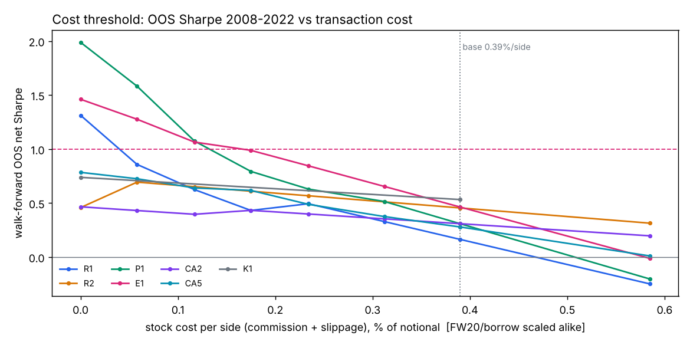
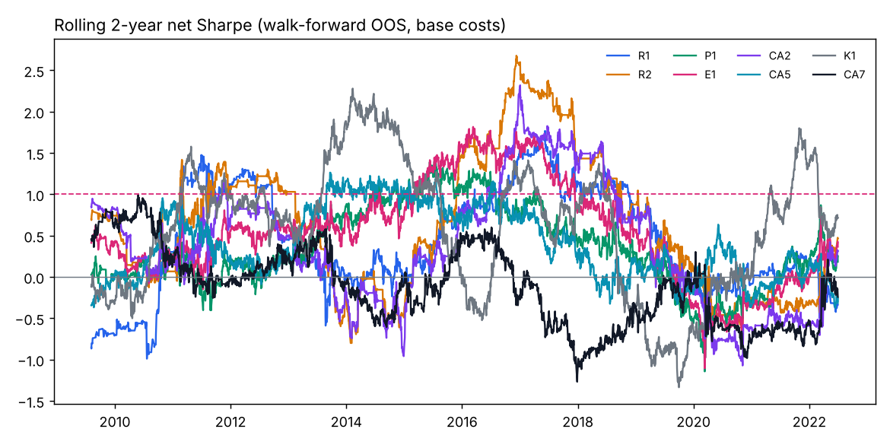

# REPORT – research WIG20 / FW20

**Wynik: nie znaleziono odpornej, opłacalnej po kosztach przewagi.** Żaden z 20 poprawnych wariantów
walk-forward nie przeszedł bramki walidacyjnej (najlepszy OOS Sharpe netto: 0.53 przy wymaganym ≥ 1.0;
Deflated Sharpe ≤ 0.06 dla wszystkich). Zgodnie z regułami **holdout (2022-07-01 →) nie został użyty** – nie było
kandydata, którego wolno by na nim sprawdzić. Pozostaje nietknięty i dostępny (jednorazowo) dla przyszłego
kandydata (`scripts/run_holdout.py`, blokada `holdout/LOCK`).

Badanie zatrzymałem na **128 wpisach w rejestrze** (z budżetu 200) – uzasadnienie w sekcji 7.

**Faza 2 (sekcje 10–13):** atak na koszty mean-reversion (35 wariantów) nie dał kandydata – dźwignie kosztowe
niszczą przewagę brutto; próg opłacalności to ~0.12–0.17%/stronę, a przewaga zanika od 2018 r. także brutto.
Event studies (31 hipotez): potwierdzone tylko efekt podatkowy dywidendy i reakcja KGHM na miedź (mała, słabnąca).
Holdout nadal nietknięty. Rejestr: 194 wpisy.

---

## 1. Dane

| Źródło | Co | Uwagi |
|---|---|---|
| GPW – archiwum notowań (oficjalne, dzienne XLS) | wszystkie serie FW20 2005–2026 (OHLC, wolumen, LOP), indeksy GPW, notowania akcji dla dni weryfikacyjnych | ~11 tys. zapytań, ~1 zapyt./s, robots.txt pozwala |
| Yahoo chart API | DAX, S&P 500, VIX, Nasdaq, Euro Stoxx, miedź, ropa, złoto, US10Y, EEM, EPOL; akcje WIG20 (`.WA`, ceny skorygowane o dywidendy) | FX z Yahoo ma błędne ticki → nie używane |
| NBP API | fixing EUR/PLN, USD/PLN, CHF/PLN | fixing 11:45, znany przed zamknięciem GPW |
| stooq / bossa | – | stooq zrywa TLS z IP kontenera, pliki bossa wymagają logowania |

Kontrola jakości (`scripts/check_data.py`, [`research/01_data_quality.md`](research/01_data_quality.md)):
* 4377 sesji 2005-01 – 2022-06 (research), 0 brakujących barów trzymanego kontraktu, 0 niespójnych OHLC; holdout:
  sprawdzona wyłącznie kompletność.
* 2013/2014: GPW notował równolegle serie z mnożnikiem 10 i 20 (`FW20H14` vs `FW20H1420`) – na kontrakt wybierana
  jedna seria o większym wolumenie, bez mieszania.
* **Rolowanie:** 3 sesje przed wygaśnięciem (3. piątek III/VI/IX/XII, przesuwany na poprzednią sesję przy święcie).
  Plan zakładał 5 sesji, ale udział wolumenu następnej serii wynosi tam tylko 9% (k=3: 34%) – zmiana podjęta
  wyłącznie na podstawie wolumenu. Zwroty liczone zawsze w obrębie jednego kontraktu (brak sztucznych skoków),
  rolowanie kosztuje 2 strony.
* Yahoo: dni świąteczne GPW jako wiersze z wolumenem 0 i fałszywą ceną (usunięte); błędne ticki otwarcia
  (ACP 2012-10-18 open=4626) – dla 50 dni z luką >10% open/high/low podmienione na oficjalne dane GPW
  (`scripts/fix_stock_gaps.py`). GPW potwierdził np. prawdziwe otwarcie PKN 2016-06-24 (Brexit) na 59.00.

## 2. Metodologia

* **Podział:** research 2005-01-01 – 2022-06-30, **holdout 2022-07-01 – 2026-10** (≈20%), ustalony w pierwszym
  commicie przed pobraniem danych; loadery researchowe obcinają dane (test jednostkowy).
* **Backtester** (`src/quant/backtest.py`): siatka zdarzeń open/close; decyzja w zdarzeniu k wykonywana po cenie
  zdarzenia k+1 (nigdy po cenie, którą widział sygnał). Dane zagraniczne łączone `merge_asof` po dacie
  (US close 22:00 dostępny dopiero na następne otwarcie GPW), dzień zamknięcia rynku zagranicznego = 0 nowej informacji.
* **Koszty (konserwatywne):** FW20 1.5 pkt poślizgu + 10 PLN prowizji / stronę (~8.7 bps); akcje 0.29% + 0.10% /
  stronę; pożyczka akcji 3% p.a.; FDAX 3 bps; finansowanie długiej nogi akcji stopą NBP + 0.25 pp (patrz sekcja 5).
  Stress test 2× koszty.
* **Walidacja:** walk-forward z rozszerzanym oknem – co rok wybór parametru po Sharpe netto z lat poprzednich,
  OOS = 2008-01 – 2022-06 (14.5 roku); ML: coroczny refit z purgingiem etykiet.
* **Bramka kandydata** (pre-commit w [`research/00_plan.md`](research/00_plan.md)): OOS Sharpe ≥ 1, DSR ≥ 0.95,
  MDD < 20%, ≥100 transakcji, sąsiedzi ±20% Sharpe ≥ 0.7, 3/3 podokresy > 0, permutacja p < 0.01, 2× koszty SR > 0.5.
* **Multiple testing:** każdy punkt siatki i każdy wynik walk-forward to wiersz w `hypotheses_log.csv` (N do DSR);
  Deflated Sharpe z wariancją SR z rejestru; Benjamini-Hochberg na p-value permutacji; White Reality Check
  (klasyczny i studentyzowany) na dziennych zwrotach OOS wszystkich poprawnych wariantów.
* **Kontrola look-ahead:** testy jednostkowe silnika + empiryczny detektor `quant/lookahead.py`: zaburza
  open/close sesji T i notowania zagraniczne z dnia T, sprawdza, że żadna wcześniejsza decyzja się nie zmienia.
  Uruchamiany dla każdego wariantu przed testem.

## 3. Co testowano (walk-forward OOS 2008-01 – 2022-06, netto)

| ID | Rodzina / hipoteza | Uzasadnienie | SR netto | SR brutto | MDD | trans. | p perm. |
|---|---|---|---|---|---|---|---|
| H006 | P1 pary bankowe/energetyczne, z-score | wspólne czynniki sektorowe | 0.31 | 1.34 | 21.1% | 586 | 0.003 |
| H011 | P2 j.w., szerokie progi | mniej transakcji | 0.21 | 0.63 | 12.1% | 158 | 0.003 |
| H018 | C1 turn-of-month | napływy OFE / pensje | −0.02 | 0.18 | 56.6% | 175 | 0.19 |
| H019 | C2 sesja przedświąteczna | efekt przedświąteczny | −0.63 | −0.25 | 36.0% | 110 | 0.86 |
| H024 | T1 TSMOM long/short | momentum szeregów czasowych | −0.11 | 0.01 | 79.1% | 176 | 0.42 |
| H028 | T2 long-only nad MA | unikanie bessy | 0.07 | 0.19 | 44.3% | 89 | 0.11 |
| H035 | M1 odwrócenie po ruchu > zσ | przereagowanie | −0.19 | −0.04 | 46.3% | 126 | 0.57 |
| H039 | M2 RSI(2) w trendzie | reguła detaliczna | −0.18 | −0.04 | 23.0% | 54 | 0.57 |
| H044 | L1 S&P(d−1) → sesja FW20 d | niedoreakcja otwarcia | −0.90 | 0.18 | 88.0% | 1220 | 0.12 |
| H062 | L2 rezydualny ruch USA po 17:00 → sesja d | j.w., czystszy sygnał | −1.06 | 0.29 | 94.1% | 1770 | 0.07 |
| H067 | L3 (DAX+S&P)(d) → sesja d+1 | j.w. | −0.70 | 0.35 | 80.1% | 1005 | 0.10 |
| H053 | F1 umocnienie PLN (fixing NBP) → long | napływ kapitału | −0.18 | 0.05 | 71.3% | 388 | 0.40 |
| H057 | O1 trend potwierdzony przyrostem LOP | pozycjonowanie | −0.25 | 0.02 | 73.6% | 361 | 0.38 |
| H071 | X1 LightGBM, 46 cech, kierunek FW20 | nieliniowości | −0.57 | 0.16 | 87.7% | 1141 | 0.30 |
| H115 | R1 rezydualne odwrócenie spółki vs FW20 (3–5 d) | dostarczanie płynności | 0.16 | 0.99 | 5.9% | 492 | 0.003 |
| H120 | R2 j.w., 10–20 d | większy ruch / ten sam koszt | 0.45 | 0.74 | 5.5% | 172 | 0.003 |
| H091 | G1 spread FW20 − β·DAX | wspólny czynnik globalny | 0.12 | 0.24 | 27.4% | 55 | 0.11 |
| H096 | G2 FW20 po odchyleniu od DAX | j.w. | −0.34 | −0.26 | 54.2% | 56 | 0.84 |
| H123 | K1 momentum przekrojowe top-4, hedge FW20 | Jegadeesh-Titman | **0.53** | 0.76 | 9.9% | 222 | 0.18 |
| H128 | E1 portfel P1 + R2 | dywersyfikacja słabych przewag | 0.46 | 1.42 | 9.5% | 758 | 0.003 |

Benchmark buy & hold FW20 (netto z rolowaniem) 2008-01 – 2022-06: **SR −0.10, MDD 64%, CAGR −5.3%**.
Buy & hold indeksu WIG20 (GPW, bez kosztów) 2008-01 – 2022-06: **SR −0.09, CAGR −4.8%, MDD 62%**; WIG20TR
(z dywidendami): SR 0.06, CAGR −1.4%, MDD 60% (`reports/benchmark_wig20.json`). Sesje WIG20 i FW20 w okresie
research pokrywają się w 100%.

Odrzucone/nieważne wiersze (INVALID, wciąż liczone do N): H005 (błąd stitchingu WF), H045–H049 (look-ahead w L2),
H072–H076 (błędne ticki Yahoo), H077–H086 i H097–H110 (R1, R2, R3, X2, K1, K2 bez kosztu finansowania długiej nogi – patrz §5; R1, R2, K1 powtórzone jako H115/H120/H123).
R3 (warunkowanie na reżim zmienności, Nagel 2012), X2 (LightGBM do selekcji transakcji R) i K2 (low-vol) miały
już przed korektą SR 0.06 / −0.22 / 0.25 i nie były powtarzane.

## 4. Statystyka wielokrotnego testowania (`reports/final_stats.json`)

* Rejestr: 128 wpisów (93 poprawne, 35 INVALID), 20 poprawnych wyników walk-forward.
* Deflated Sharpe: próg SR₀ (oczekiwane maksimum SR przy zerowej przewadze) ≈ **1.3–1.4 rocznie**; DSR wszystkich
  wariantów ≤ 0.06 (większość 0.00). Kandydat musiałby mieć OOS SR rzędu ≥ 1.7, żeby DSR > 0.95.
* White Reality Check (H0: żadna z 20 strategii nie ma dodatniej średniej): p = 0.94; wersja studentyzowana p = 0.28.
* BH (q=5%) na p-value permutacji: istotne P1, P2, R1, R2, E1 – tzn. **wybór momentu wejścia** w strategiach
  relative value jest lepszy od losowego przy tej samej ekspozycji, ale ich średni zwrot netto nie jest istotnie
  > 0 po uwzględnieniu przeszukiwania.

Wrażliwość na koszty (opis, nie test – `reports/cost_sensitivity.json`), Sharpe OOS przy mnożniku kosztów:

| | 0× | 0.25× | 0.5× | 0.75× | 1× (baza) | 2× |
|---|---|---|---|---|---|---|
| E1 (pary + R2) | 1.42 | 1.18 | 0.94 | 0.70 | 0.46 | −0.48 |
| R2 | 0.74 | 0.67 | 0.60 | 0.53 | 0.45 | 0.17 |
| K1 | 0.76 | 0.70 | 0.64 | 0.59 | 0.53 | 0.31 |

## 5. Błędy znalezione po drodze (sceptycyzm wobec własnych wyników)

1. **Stitching walk-forward** (H005): „hold” (NaN) na zdarzeniach open zamieniany na 0 → codzienne fikcyjne
   transakcje (SR −14). Naprawione, test regresyjny.
2. **Look-ahead w L2** (H045–H049): reszta S&P liczona względem zwrotu FW20 z dnia handlu → brutto SR 2.26 /
   netto 0.79 przy p=0.003. „Za dobrze” → szukanie błędu → poprawka → SR −1.06. Powstał detektor look-ahead.
3. **Błędne ticki Yahoo** (H072–H076): ann_vol 166% przy MDD 6% – sprzeczność zdradziła open=4626 w ACP.
4. **Carry ukryty w hedgu** (R/K/X2): FW20 jest wyceniany z (r − q), więc długa akcja + krótki FW20 zarabia stopę
   bez ryzyka, jeśli nie obciąży się finansowania nogi akcyjnej. Korekta: stopa referencyjna NBP + 0.25 pp
   (roczne średnie wpisane ręcznie – strona NBP jest za ścianą anty-botową); SR R2 0.50 → 0.45, K1 0.68 → 0.53.

## 6. Wnioski merytoryczne

* **Kierunek FW20 w horyzoncie dziennym jest w praktyce nieprzewidywalny** z danych EOD: kalendarz, trend,
  mean-reversion, FX, LOP, lead-lag z USA/DAX i ML dają brutto SR OOS ≤ 0.35. Informacja z sesji amerykańskiej
  jest wyceniana na otwarciu FW20 (brak sesji wieczornej), a resztkowy dryf w sesji jest za mały wobec kosztu
  ~17 bps round-trip.
* **Jedyny realny sygnał to relatywna mean-reversion między spółkami** (pary, odwrócenie rezydualne): istotna
  w permutacjach, brutto SR 0.7–1.4, ale koszty detaliczne akcji (0.39%/stronę) zjadają 50–80% przewagi.
  Przy ~½ kosztów portfel E1 dawałby OOS SR ≈ 0.94 – nadal poniżej progu i daleko od progu DSR.
* Momentum przekrojowe w WIG20 (K1, SR 0.53) nie odróżnia się od losowego timingu (p=0.18).

## 7. Dlaczego zatrzymałem się przed limitem 200

Pokryte zostały wszystkie rodziny z przestrzeni startowej (lead-lag, MR/momentum, pary, kalendarz, reżimy
zmienności, FX, ML) plus trzy dodatkowe (rezydualne odwrócenie z hedgem FW20, FW20 vs DAX, czynniki przekrojowe).
Obraz jest spójny, a każdy kolejny test podnosi próg DSR (już ~1.4). Kolejne warianty byłyby albo dostrajaniem
parametrów rodzin, które już zawiodły (czego reguły zabraniają), albo pomysłami bez danych w tym środowisku
(intraday, dywidendy, skład indeksu). Wydawanie reszty budżetu tylko po to, żeby go wyczerpać, byłoby mieleniem
parametrów.

## 8. Ograniczenia i ryzyka

* **Survivorship bias:** uniwersum akcji = obecne/długoletnie spółki WIG20 (Yahoo nie ma np. Lotosu, PGNiG);
  wyniki P/R/K są przez to raczej zawyżone – nie zmienia to negatywnego wniosku.
* Ceny akcji z Yahoo (korekta dywidend Yahoo nie weryfikowana pozycja po pozycji), open/high/low poprawione
  tylko w 50 dniach z luką > 10%.
* Brak danych intraday (bossa wymaga logowania) → nie dało się testować strategii reagujących na otwarcie
  (luka otwarcia, pierwsze minuty) bez łamania reguły „wejście na następnym barze”.
* Stopy NBP wpisane ręcznie w rocznych średnich (2026 – szacunek); błąd ±0.5 pp zmienia SR R/K o setne części.
* Koszty FW20 przyjęte jak przy mnożniku 20 PLN dla całego okresu; przy starym mnożniku 10 PLN prowizja w punktach
  była wyższa (stress 2× to pokrywa). DAX z Yahoo jako proxy FDAX (indeks total return).
* Model kosztów akcji jest detaliczny i konserwatywny – część przewag relative value mogłaby istnieć przy kosztach
  instytucjonalnych, ale to poza założeniami projektu, a i tak nie przeszłaby DSR.

## 9. Co dalej (jeśli ktoś chce kontynuować)

1. Dane intraday FW20 (np. płatne lub z kontem bossa) → strategie na otwarciu i reakcje na sesję USA w trakcie dnia.
2. Realne koszty instytucjonalne / kontrakty na akcje dla rodzin P/R (sprawdzić płynność serii akcyjnych na GPW).
3. Historyczny skład WIG20 (eliminacja survivorship bias).
4. Każdy nowy kandydat: dopisać do `catalog.py`, uruchomić `check_lookahead.py`, `h_fw20.py` (rejestr), a dopiero
   po przejściu bramki zapisać `holdout/candidate.json` i jednorazowo `run_holdout.py`.

---

# FAZA 2 (2026-10-31): koszty, stabilność, eventy

Zasady bez zmian (holdout nietknięty, ten sam rejestr, DSR liczony od łącznej liczby testów). Budżet rejestru
podniesiony do 228 (128 + 40 na część 1 + 60 na część 3) zgodnie z poleceniem.

## 10. Część 1 – atak na koszty relatywnej mean-reversion (H129–H163, 35/40 wariantów)

Ten sam sygnał (rezydualne odwrócenie spółki vs FW20, pary), zmieniane tylko *kiedy* i *czym* handlujemy.
Szczegóły: [`research/06_cost_attack.md`](research/06_cost_attack.md).

| ID | dźwignia | SR netto | SR brutto | trans. | MDD |
|---|---|---|---|---|---|
| (H120) | R2 – punkt odniesienia | 0.45 | 0.74 | 172 | 5.5% |
| H133 | CA1 rebalancing tygodniowy | −0.10 | 0.14 | 130 | 9.5% |
| H138 | CA2 histereza (wyjście dopiero po pełnym powrocie) | 0.31 | 0.53 | 161 | 8.9% |
| H143 | CA3 tylko top-8 najpłynniejszych (kauzalny ranking obrotu) | 0.07 | 0.32 | 89 | 4.0% |
| H148 | CA4 kontrakty na akcje GPW (0.25%/stronę) zamiast akcji | −0.13 | 0.27 | 174 | 11.2% |
| H153 | CA5 pary tygodniowo + wyjście przy pełnym powrocie | 0.28 | 0.85 | 306 | 14.6% |
| H158 | CA6 top-8 + co 2 tygodnie + histereza | −0.10 | 0.03 | 37 | 5.0% |
| H163 | CA7 pary tylko PKO/PEO/PZU | −0.16 | 0.67 | 248 | 45.4% |

**Dźwignie kosztowe niszczą przewagę brutto szybciej, niż oszczędzają koszty.** Przewaga wygasa w ciągu dni
(rebalancing tygodniowy obcina brutto SR 0.74 → 0.14) i siedzi w mniej płynnych nazwach (top-8: brutto 0.32,
PKO/PEO/PZU: 0.67 vs 1.3–2.0 dla pełnego koszyka par). To spójne z interpretacją odwrócenia jako premii za
dostarczanie płynności – płaci tam, gdzie płynność jest droga. Kontrakty na akcje GPW są cienkie
(FKGH/FCDR ~0.9 mln PLN/dzień, FPKO/FPEO ~0.16 mln, FPGE/FTPE ~10–20 tys., do 18% dni bez transakcji).
Hedge betą FW20 (rodzina R) vs pełne L/S na akcjach (P): P ma wyższe brutto, ale płaci dwie nogi akcyjne
i pożyczkę – po kosztach oba ≈ 0.3–0.45.

### Próg kosztów

Pełny walk-forward (parametry wybierane ponownie) przy przeskalowanych kosztach (`scripts/phase2_costs.py`):

| koszt akcji / stronę / nogę | P1 pary | E1 portfel | R1 | R2 |
|---|---|---|---|---|
| 0.00% | 1.99 | 1.46 | 1.31 | 0.46 |
| 0.12% | 1.07 | 1.06 | 0.62 | 0.65 |
| 0.18% | 0.79 | 0.99 | 0.43 | 0.61 |
| 0.39% (baza) | 0.31 | 0.46 | 0.16 | 0.45 |

**Próg: SR OOS = 1.0 przy ~0.12%/stronę (pary P1) i ~0.17% (portfel E1)** – czyli ~⅓ kosztów bazowych.
Nawet wtedy DSR (próg SR₀ ≈ 1.4–1.7 przy obecnej liczbie testów) nie przechodzi, a część 2 pokazuje, że
przewaga zanika. Koszt ~0.1% all-in jest dziś osiągalny (broker z zerową prowizją do limitu obrotu + poślizg),
ale wybór modelu kosztów po obejrzeniu wyników byłby oszustwem – opisane w THEORIES.md jako teoria do weryfikacji.

## 11. Część 2 – stabilność w czasie

| wariant | 2008–2012 | 2013–2017 | 2018–2022H1 | brutto 2008–12 → 2013–17 → 2018–22 | werdykt |
|---|---|---|---|---|---|
| R2 | 0.73 | 1.05 | 0.00 | 0.96 → 1.47 → 0.27 | zanika – odrzucony |
| E1 | 0.51 | 1.02 | 0.05 | 1.38 → 2.33 → 0.86 | zanika – odrzucony |
| P1 | 0.20 | 0.71 | 0.07 | 1.14 → 1.98 → 0.99 | zanika – odrzucony |
| CA2 | 0.60 | 0.80 | −0.21 | – | zanika – odrzucony |
| CA5 | 0.33 | 0.55 | 0.02 | – | zanika – odrzucony |
| R1 | −0.03 | 0.87 | −0.19 | – | odrzucony |
| CA7 | 0.19 | −0.37 | −0.27 | – | odrzucony |
| K1 (momentum) | 0.27 | 1.02 | 0.38 | 0.47 → 1.30 → 0.59 | stabilny, ale nieistotny (perm. p=0.18) |

Wszystkie warianty relative value mają szczyt w 2016–2017 i rolling 2-letni Sharpe < 0 w 2019–2021.
**Zanika przewaga brutto przy stałym obrocie** – to zmiana rynku, nie kosztów. Rodzina zamknięta dla
automatycznego tradingu. Szczegóły: [`research/07_stability.md`](research/07_stability.md).

## 12. Część 3 – event studies i nietypowe źródła (H164–H194, 31/60 hipotez)

Pre-specyfikowane w `scripts/phase3_events.py`; N, 95% CI (bootstrap), p (t-test), korekta BH i Bonferroni po
wszystkich 31. Szczegóły i studia przypadków: [`research/08_events.md`](research/08_events.md),
tabele: `reports/phase3/`.

**(1) Potwierdzone statystycznie (przeżywają BH i Bonferroniego):**

| ID | zależność | N | efekt | 95% CI | uwagi |
|---|---|---|---|---|---|
| H170/H173 | Kurs w dniu odcięcia dywidendy spada o ~79% dywidendy (AR total return +0.77%) | 237 | +0.77% | [+0.49, +1.04] | = 19% podatek; stabilne w 3 podokresach; nie arbitraż po podatku |
| H183 | Sesja KGHM (open→close) podąża za ruchem miedzi z poprzedniego dnia | 4219 | nachylenie 0.084 | [0.045, 0.122] | placebo PKN/PKO = 0; **słabnie** (2018–22 nieistotne) |

**(2) Obiecujące, ale słabe dowody (p < 0.10 bez korekty, nie przeżywają BH):** KGH po dużym ruchu miedzi
(|Δ| > 2σ) +0.34% vs WIG20 w sesji (N=235, p=0.017 – poniżej kosztu round-trip); dryf po szoku wolumenu w sezonie
wyników (+0.79% w 10 dni, N=324, p=0.06); dodanie do WIG20: +2.1% przed i −2.5% po rewizji (N=27, p=0.07/0.04);
CD Projekt po premierze −10.5% (N=5, wszystkie ujemne).

**Brak efektu:** decyzje RPP (FW20 i banki), wybory (SP vs prywatne), wyroki CHF (N=5; szok SNB 2015 był
ważniejszy niż orzeczenia), wygasanie FW20 (średnia), szoki EUR/PLN, crack spread → Orlen, powolna dyfuzja
miedzi w KGHM (20 dni), run-up przed dywidendą, usunięcia z WIG20.

**(3) Tylko teoria (brak danych w środowisku):** krótkie pozycje KNF, transakcje insiderów (MAR/ESPI),
przepływy funduszy (IZFA), OFE/PPK, rekomendacje, sentyment/Google Trends, typy komunikatów ESPI, zaskoczenia
CPI/PKB, rentowności obligacji – opisane z konkretnymi krokami weryfikacji w [`THEORIES.md`](THEORIES.md).
Praktyczna ściąga: [`DISCRETIONARY_PLAYBOOK.md`](DISCRETIONARY_PLAYBOOK.md).

## 13. Podsumowanie fazy 2

* **Realne:** (a) relatywna mean-reversion spółek WIG20 brutto (permutacje p=0.003) – ale wymaga kosztów
  ≤ ~0.12–0.17%/stronę i **zanika od 2018 r. także brutto**; (b) efekt podatkowy dnia dywidendy (stabilny,
  ale nie do zarobienia po podatku); (c) KGHM nie dyskontuje w pełni nocnego ruchu miedzi na otwarciu
  (mały, słabnący).
* **Obiecujące (wymaga lepszych danych):** pary przy kosztach brokera bez prowizji (teoria #1 w THEORIES.md),
  dodania do WIG20 (run-up/odwrócenie), PEAD na prawdziwych datach raportów, krótkie pozycje KNF, zakupy insiderów.
* **Zamknąć:** wszystko, co próbuje przewidzieć kierunek FW20 z danych dziennych (kalendarz, trend, lead-lag,
  FX, RPP, wygasanie, ML) – zero sygnału w ~100 testach; dźwignie kosztowe dla mean-reversion (niszczą sygnał).
* Kandydata do holdoutu nadal brak – **holdout nietknięty**. Rejestr: 194 wpisy (budżet 228).
