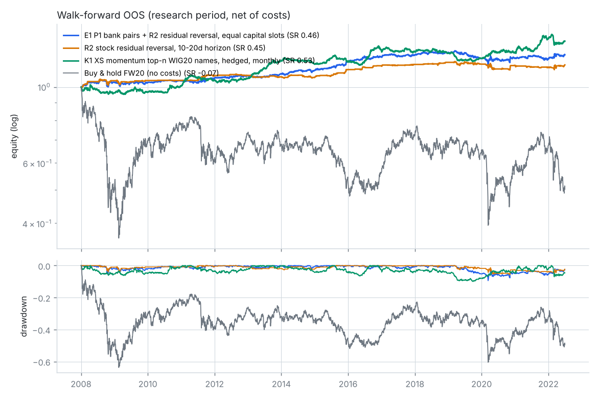
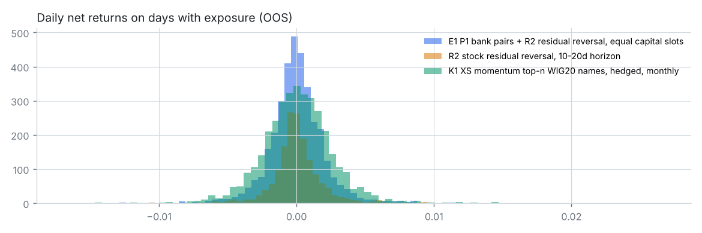
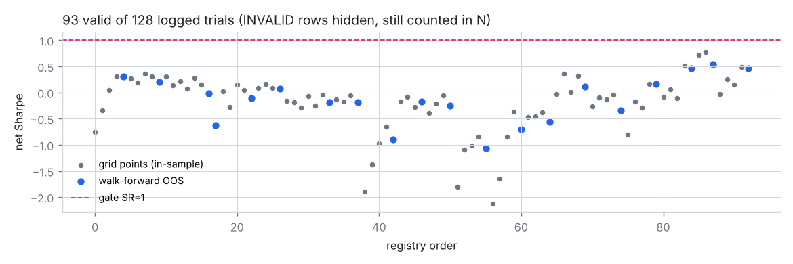

# REPORT – research WIG20 / FW20

**Wynik: nie znaleziono odpornej, opłacalnej po kosztach przewagi.** Żaden z 20 poprawnych wariantów
walk-forward nie przeszedł bramki walidacyjnej (najlepszy OOS Sharpe netto: 0.53 przy wymaganym ≥ 1.0;
Deflated Sharpe ≤ 0.06 dla wszystkich). Zgodnie z regułami **holdout (2022-07-01 →) nie został użyty** – nie było
kandydata, którego wolno by na nim sprawdzić. Pozostaje nietknięty i dostępny (jednorazowo) dla przyszłego
kandydata (`scripts/run_holdout.py`, blokada `holdout/LOCK`).

Badanie zatrzymałem na **128 wpisach w rejestrze** (z budżetu 200) – uzasadnienie w sekcji 7.

---

## 1. Dane

| Źródło | Co | Uwagi |
|---|---|---|
| GPW – archiwum notowań (oficjalne, dzienne XLS) | wszystkie serie FW20 2005–2026 (OHLC, wolumen, LOP), indeksy GPW, notowania akcji dla dni weryfikacyjnych | ~11 tys. zapytań, ~1 zapyt./s, robots.txt pozwala |
| Yahoo chart API | DAX, S&P 500, VIX, Nasdaq, Euro Stoxx, miedź, ropa, złoto, US10Y, EEM, EPOL; akcje WIG20 (`.WA`, ceny skorygowane o dywidendy) | FX z Yahoo ma błędne ticki → nie używane |
| NBP API | fixing EUR/PLN, USD/PLN, CHF/PLN | fixing 11:45, znany przed zamknięciem GPW |
| stooq / bossa | – | stooq zrywa TLS z IP kontenera, pliki bossa wymagają logowania |

Kontrola jakości (`scripts/check_data.py`, [`research/01_data_quality.md`](research/01_data_quality.md)):
* 4377 sesji 2005-01 – 2022-06 (research), 0 brakujących barów trzymanego kontraktu, 0 niespójnych OHLC; holdout:
  sprawdzona wyłącznie kompletność.
* 2013/2014: GPW notował równolegle serie z mnożnikiem 10 i 20 (`FW20H14` vs `FW20H1420`) – na kontrakt wybierana
  jedna seria o większym wolumenie, bez mieszania.
* **Rolowanie:** 3 sesje przed wygaśnięciem (3. piątek III/VI/IX/XII, przesuwany na poprzednią sesję przy święcie).
  Plan zakładał 5 sesji, ale udział wolumenu następnej serii wynosi tam tylko 9% (k=3: 34%) – zmiana podjęta
  wyłącznie na podstawie wolumenu. Zwroty liczone zawsze w obrębie jednego kontraktu (brak sztucznych skoków),
  rolowanie kosztuje 2 strony.
* Yahoo: dni świąteczne GPW jako wiersze z wolumenem 0 i fałszywą ceną (usunięte); błędne ticki otwarcia
  (ACP 2012-10-18 open=4626) – dla 50 dni z luką >10% open/high/low podmienione na oficjalne dane GPW
  (`scripts/fix_stock_gaps.py`). GPW potwierdził np. prawdziwe otwarcie PKN 2016-06-24 (Brexit) na 59.00.

## 2. Metodologia

* **Podział:** research 2005-01-01 – 2022-06-30, **holdout 2022-07-01 – 2026-10** (≈20%), ustalony w pierwszym
  commicie przed pobraniem danych; loadery researchowe obcinają dane (test jednostkowy).
* **Backtester** (`src/quant/backtest.py`): siatka zdarzeń open/close; decyzja w zdarzeniu k wykonywana po cenie
  zdarzenia k+1 (nigdy po cenie, którą widział sygnał). Dane zagraniczne łączone `merge_asof` po dacie
  (US close 22:00 dostępny dopiero na następne otwarcie GPW), dzień zamknięcia rynku zagranicznego = 0 nowej informacji.
* **Koszty (konserwatywne):** FW20 1.5 pkt poślizgu + 10 PLN prowizji / stronę (~8.7 bps); akcje 0.29% + 0.10% /
  stronę; pożyczka akcji 3% p.a.; FDAX 3 bps; finansowanie długiej nogi akcji stopą NBP + 0.25 pp (patrz sekcja 5).
  Stress test 2× koszty.
* **Walidacja:** walk-forward z rozszerzanym oknem – co rok wybór parametru po Sharpe netto z lat poprzednich,
  OOS = 2008-01 – 2022-06 (14.5 roku); ML: coroczny refit z purgingiem etykiet.
* **Bramka kandydata** (pre-commit w [`research/00_plan.md`](research/00_plan.md)): OOS Sharpe ≥ 1, DSR ≥ 0.95,
  MDD < 20%, ≥100 transakcji, sąsiedzi ±20% Sharpe ≥ 0.7, 3/3 podokresy > 0, permutacja p < 0.01, 2× koszty SR > 0.5.
* **Multiple testing:** każdy punkt siatki i każdy wynik walk-forward to wiersz w `hypotheses_log.csv` (N do DSR);
  Deflated Sharpe z wariancją SR z rejestru; Benjamini-Hochberg na p-value permutacji; White Reality Check
  (klasyczny i studentyzowany) na dziennych zwrotach OOS wszystkich poprawnych wariantów.
* **Kontrola look-ahead:** testy jednostkowe silnika + empiryczny detektor `quant/lookahead.py`: zaburza
  open/close sesji T i notowania zagraniczne z dnia T, sprawdza, że żadna wcześniejsza decyzja się nie zmienia.
  Uruchamiany dla każdego wariantu przed testem.

## 3. Co testowano (walk-forward OOS 2008-01 – 2022-06, netto)

| ID | Rodzina / hipoteza | Uzasadnienie | SR netto | SR brutto | MDD | trans. | p perm. |
|---|---|---|---|---|---|---|---|
| H006 | P1 pary bankowe/energetyczne, z-score | wspólne czynniki sektorowe | 0.31 | 1.34 | 21.1% | 586 | 0.003 |
| H011 | P2 j.w., szerokie progi | mniej transakcji | 0.21 | 0.63 | 12.1% | 158 | 0.003 |
| H018 | C1 turn-of-month | napływy OFE / pensje | −0.02 | 0.18 | 56.6% | 175 | 0.19 |
| H019 | C2 sesja przedświąteczna | efekt przedświąteczny | −0.63 | −0.25 | 36.0% | 110 | 0.86 |
| H024 | T1 TSMOM long/short | momentum szeregów czasowych | −0.11 | 0.01 | 79.1% | 176 | 0.42 |
| H028 | T2 long-only nad MA | unikanie bessy | 0.07 | 0.19 | 44.3% | 89 | 0.11 |
| H035 | M1 odwrócenie po ruchu > zσ | przereagowanie | −0.19 | −0.04 | 46.3% | 126 | 0.57 |
| H039 | M2 RSI(2) w trendzie | reguła detaliczna | −0.18 | −0.04 | 23.0% | 54 | 0.57 |
| H044 | L1 S&P(d−1) → sesja FW20 d | niedoreakcja otwarcia | −0.90 | 0.18 | 88.0% | 1220 | 0.12 |
| H062 | L2 rezydualny ruch USA po 17:00 → sesja d | j.w., czystszy sygnał | −1.06 | 0.29 | 94.1% | 1770 | 0.07 |
| H067 | L3 (DAX+S&P)(d) → sesja d+1 | j.w. | −0.70 | 0.35 | 80.1% | 1005 | 0.10 |
| H053 | F1 umocnienie PLN (fixing NBP) → long | napływ kapitału | −0.18 | 0.05 | 71.3% | 388 | 0.40 |
| H057 | O1 trend potwierdzony przyrostem LOP | pozycjonowanie | −0.25 | 0.02 | 73.6% | 361 | 0.38 |
| H071 | X1 LightGBM, 46 cech, kierunek FW20 | nieliniowości | −0.57 | 0.16 | 87.7% | 1141 | 0.30 |
| H115 | R1 rezydualne odwrócenie spółki vs FW20 (3–5 d) | dostarczanie płynności | 0.16 | 0.99 | 5.9% | 492 | 0.003 |
| H120 | R2 j.w., 10–20 d | większy ruch / ten sam koszt | 0.45 | 0.74 | 5.5% | 172 | 0.003 |
| H091 | G1 spread FW20 − β·DAX | wspólny czynnik globalny | 0.12 | 0.24 | 27.4% | 55 | 0.11 |
| H096 | G2 FW20 po odchyleniu od DAX | j.w. | −0.34 | −0.26 | 54.2% | 56 | 0.84 |
| H123 | K1 momentum przekrojowe top-4, hedge FW20 | Jegadeesh-Titman | **0.53** | 0.76 | 9.9% | 222 | 0.18 |
| H128 | E1 portfel P1 + R2 | dywersyfikacja słabych przewag | 0.46 | 1.42 | 9.5% | 758 | 0.003 |

Benchmark buy & hold FW20 (netto z rolowaniem) 2008-01 – 2022-06: **SR −0.10, MDD 64%, CAGR −5.3%**.
Buy & hold indeksu WIG20 (GPW, bez kosztów) 2008-01 – 2022-06: **SR −0.09, CAGR −4.8%, MDD 62%**; WIG20TR
(z dywidendami): SR 0.06, CAGR −1.4%, MDD 60% (`reports/benchmark_wig20.json`). Sesje WIG20 i FW20 w okresie
research pokrywają się w 100%.

Odrzucone/nieważne wiersze (INVALID, wciąż liczone do N): H005 (błąd stitchingu WF), H045–H049 (look-ahead w L2),
H072–H076 (błędne ticki Yahoo), H077–H086 i H097–H110 (R1, R2, R3, X2, K1, K2 bez kosztu finansowania długiej nogi – patrz §5; R1, R2, K1 powtórzone jako H115/H120/H123).
R3 (warunkowanie na reżim zmienności, Nagel 2012), X2 (LightGBM do selekcji transakcji R) i K2 (low-vol) miały
już przed korektą SR 0.06 / −0.22 / 0.25 i nie były powtarzane.

## 4. Statystyka wielokrotnego testowania (`reports/final_stats.json`)

* Rejestr: 128 wpisów (93 poprawne, 35 INVALID), 20 poprawnych wyników walk-forward.
* Deflated Sharpe: próg SR₀ (oczekiwane maksimum SR przy zerowej przewadze) ≈ **1.3–1.4 rocznie**; DSR wszystkich
  wariantów ≤ 0.06 (większość 0.00). Kandydat musiałby mieć OOS SR rzędu ≥ 1.7, żeby DSR > 0.95.
* White Reality Check (H0: żadna z 20 strategii nie ma dodatniej średniej): p = 0.94; wersja studentyzowana p = 0.28.
* BH (q=5%) na p-value permutacji: istotne P1, P2, R1, R2, E1 – tzn. **wybór momentu wejścia** w strategiach
  relative value jest lepszy od losowego przy tej samej ekspozycji, ale ich średni zwrot netto nie jest istotnie
  > 0 po uwzględnieniu przeszukiwania.

Wrażliwość na koszty (opis, nie test – `reports/cost_sensitivity.json`), Sharpe OOS przy mnożniku kosztów:

| | 0× | 0.25× | 0.5× | 0.75× | 1× (baza) | 2× |
|---|---|---|---|---|---|---|
| E1 (pary + R2) | 1.42 | 1.18 | 0.94 | 0.70 | 0.46 | −0.48 |
| R2 | 0.74 | 0.67 | 0.60 | 0.53 | 0.45 | 0.17 |
| K1 | 0.76 | 0.70 | 0.64 | 0.59 | 0.53 | 0.31 |

## 5. Błędy znalezione po drodze (sceptycyzm wobec własnych wyników)

1. **Stitching walk-forward** (H005): „hold” (NaN) na zdarzeniach open zamieniany na 0 → codzienne fikcyjne
   transakcje (SR −14). Naprawione, test regresyjny.
2. **Look-ahead w L2** (H045–H049): reszta S&P liczona względem zwrotu FW20 z dnia handlu → brutto SR 2.26 /
   netto 0.79 przy p=0.003. „Za dobrze” → szukanie błędu → poprawka → SR −1.06. Powstał detektor look-ahead.
3. **Błędne ticki Yahoo** (H072–H076): ann_vol 166% przy MDD 6% – sprzeczność zdradziła open=4626 w ACP.
4. **Carry ukryty w hedgu** (R/K/X2): FW20 jest wyceniany z (r − q), więc długa akcja + krótki FW20 zarabia stopę
   bez ryzyka, jeśli nie obciąży się finansowania nogi akcyjnej. Korekta: stopa referencyjna NBP + 0.25 pp
   (roczne średnie wpisane ręcznie – strona NBP jest za ścianą anty-botową); SR R2 0.50 → 0.45, K1 0.68 → 0.53.

## 6. Wnioski merytoryczne

* **Kierunek FW20 w horyzoncie dziennym jest w praktyce nieprzewidywalny** z danych EOD: kalendarz, trend,
  mean-reversion, FX, LOP, lead-lag z USA/DAX i ML dają brutto SR OOS ≤ 0.35. Informacja z sesji amerykańskiej
  jest wyceniana na otwarciu FW20 (brak sesji wieczornej), a resztkowy dryf w sesji jest za mały wobec kosztu
  ~17 bps round-trip.
* **Jedyny realny sygnał to relatywna mean-reversion między spółkami** (pary, odwrócenie rezydualne): istotna
  w permutacjach, brutto SR 0.7–1.4, ale koszty detaliczne akcji (0.39%/stronę) zjadają 50–80% przewagi.
  Przy ~½ kosztów portfel E1 dawałby OOS SR ≈ 0.94 – nadal poniżej progu i daleko od progu DSR.
* Momentum przekrojowe w WIG20 (K1, SR 0.53) nie odróżnia się od losowego timingu (p=0.18).

## 7. Dlaczego zatrzymałem się przed limitem 200

Pokryte zostały wszystkie rodziny z przestrzeni startowej (lead-lag, MR/momentum, pary, kalendarz, reżimy
zmienności, FX, ML) plus trzy dodatkowe (rezydualne odwrócenie z hedgem FW20, FW20 vs DAX, czynniki przekrojowe).
Obraz jest spójny, a każdy kolejny test podnosi próg DSR (już ~1.4). Kolejne warianty byłyby albo dostrajaniem
parametrów rodzin, które już zawiodły (czego reguły zabraniają), albo pomysłami bez danych w tym środowisku
(intraday, dywidendy, skład indeksu). Wydawanie reszty budżetu tylko po to, żeby go wyczerpać, byłoby mieleniem
parametrów.

## 8. Ograniczenia i ryzyka

* **Survivorship bias:** uniwersum akcji = obecne/długoletnie spółki WIG20 (Yahoo nie ma np. Lotosu, PGNiG);
  wyniki P/R/K są przez to raczej zawyżone – nie zmienia to negatywnego wniosku.
* Ceny akcji z Yahoo (korekta dywidend Yahoo nie weryfikowana pozycja po pozycji), open/high/low poprawione
  tylko w 50 dniach z luką > 10%.
* Brak danych intraday (bossa wymaga logowania) → nie dało się testować strategii reagujących na otwarcie
  (luka otwarcia, pierwsze minuty) bez łamania reguły „wejście na następnym barze”.
* Stopy NBP wpisane ręcznie w rocznych średnich (2026 – szacunek); błąd ±0.5 pp zmienia SR R/K o setne części.
* Koszty FW20 przyjęte jak przy mnożniku 20 PLN dla całego okresu; przy starym mnożniku 10 PLN prowizja w punktach
  była wyższa (stress 2× to pokrywa). DAX z Yahoo jako proxy FDAX (indeks total return).
* Model kosztów akcji jest detaliczny i konserwatywny – część przewag relative value mogłaby istnieć przy kosztach
  instytucjonalnych, ale to poza założeniami projektu, a i tak nie przeszłaby DSR.

## 9. Co dalej (jeśli ktoś chce kontynuować)

1. Dane intraday FW20 (np. płatne lub z kontem bossa) → strategie na otwarciu i reakcje na sesję USA w trakcie dnia.
2. Realne koszty instytucjonalne / kontrakty na akcje dla rodzin P/R (sprawdzić płynność serii akcyjnych na GPW).
3. Historyczny skład WIG20 (eliminacja survivorship bias).
4. Każdy nowy kandydat: dopisać do `catalog.py`, uruchomić `check_lookahead.py`, `h_fw20.py` (rejestr), a dopiero
   po przejściu bramki zapisać `holdout/candidate.json` i jednorazowo `run_holdout.py`.
